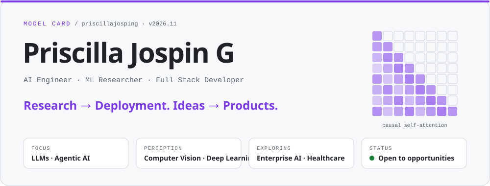
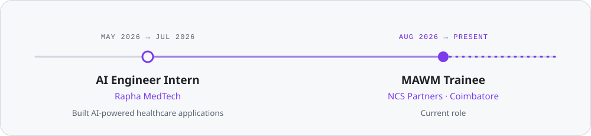
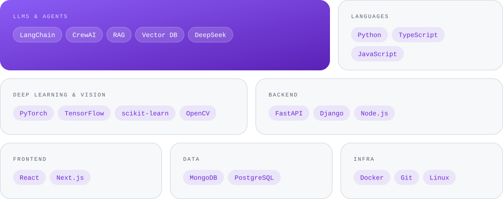
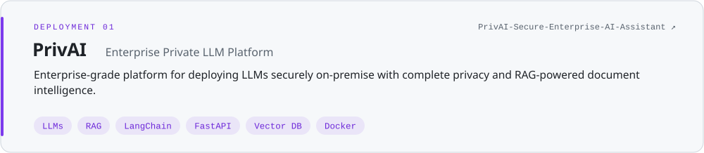
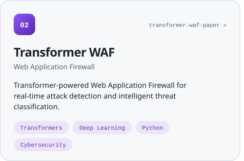
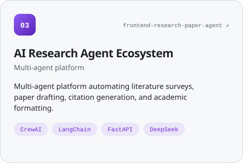
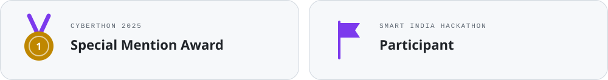
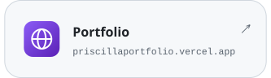

  <i>“But when that which is complete and perfect comes, that which is incomplete and partial will pass away.”</i> 
  1 Corinthians 13:10

 

<a href="https://priscillaportfolio.vercel.app/"><picture><source media="(prefers-color-scheme: dark)" srcset="assets/hero-dark.svg"></picture></a>

  
  
  

 

<picture><source media="(prefers-color-scheme: dark)" srcset="assets/h-journey-dark.svg"></picture>

<picture><source media="(prefers-color-scheme: dark)" srcset="assets/experience-dark.svg"></picture>

 

<picture><source media="(prefers-color-scheme: dark)" srcset="assets/h-toolkit-dark.svg"></picture>

<picture><source media="(prefers-color-scheme: dark)" srcset="assets/stack-dark.svg"></picture>

 

<picture><source media="(prefers-color-scheme: dark)" srcset="assets/h-work-dark.svg"></picture>

<a href="https://github.com/PriscillajospinG/PrivAI-Secure-Enterprise-AI-Assistant"><picture><source media="(prefers-color-scheme: dark)" srcset="assets/project-privai-dark.svg"></picture></a>

  <a href="https://github.com/PriscillajospinG/transformer-waf-paper"><picture><source media="(prefers-color-scheme: dark)" srcset="assets/project-waf-dark.svg"></picture></a><a href="https://github.com/PriscillajospinG/frontend-research-paper-agent"><picture><source media="(prefers-color-scheme: dark)" srcset="assets/project-agent-dark.svg"></picture></a>

 

<picture><source media="(prefers-color-scheme: dark)" srcset="assets/h-recognition-dark.svg"></picture>

<picture><source media="(prefers-color-scheme: dark)" srcset="assets/achievements-dark.svg"></picture>

  <picture><source media="(prefers-color-scheme: dark)" srcset="https://github-readme-stats.vercel.app/api?username=PriscillajospinG&show_icons=true&hide_border=true&border_radius=20&count_private=true&bg_color=161b22&title_color=a78bfa&icon_color=8b5cf6&text_color=e6edf3"></picture>
  <picture><source media="(prefers-color-scheme: dark)" srcset="https://github-readme-stats.vercel.app/api/top-langs/?username=PriscillajospinG&layout=compact&hide_border=true&border_radius=20&langs_count=6&bg_color=161b22&title_color=a78bfa&text_color=e6edf3"></picture>

  <picture><source media="(prefers-color-scheme: dark)" srcset="https://streak-stats.demolab.com?user=PriscillajospinG&hide_border=true&border_radius=20&background=161b22&ring=8b5cf6&fire=8b5cf6&currStreakLabel=a78bfa&sideLabels=e6edf3&dates=8b949e&sideNums=e6edf3&currStreakNum=e6edf3&stroke=30363d"></picture>

 

<picture><source media="(prefers-color-scheme: dark)" srcset="assets/h-connect-dark.svg"></picture>

  <a href="https://www.linkedin.com/in/priscilla-jospin-g-a52799295/"><picture><source media="(prefers-color-scheme: dark)" srcset="assets/connect-linkedin-dark.svg"></picture></a><a href="https://priscillaportfolio.vercel.app/"><picture><source media="(prefers-color-scheme: dark)" srcset="assets/connect-portfolio-dark.svg"></picture></a><a href="mailto:priscillajospin@gmail.com"><picture><source media="(prefers-color-scheme: dark)" srcset="assets/connect-email-dark.svg"></picture></a>

 

  <picture>
    <source media="(prefers-color-scheme: dark)" srcset="https://raw.githubusercontent.com/PriscillajospinG/PriscillajospinG/output/github-contribution-grid-snake-dark.svg">
    
  </picture>

