<i>“But when that which is complete and perfect comes, that which is incomplete and partial will pass away.”</i> 
— 1 Corinthians 13:10

  

  

 &nbsp;
 &nbsp;

 

## About

🎓 &nbsp;B.Tech AI & Data Science — Karunya Institute of Science and Technology 
💼 &nbsp;MAWM Trainee @ NCS Partners, Coimbatore 
🧠 &nbsp;Interested in LLMs, Agentic AI, Computer Vision, and Deep Learning 
🚀 &nbsp;Passionate about transforming research ideas into deployable AI products 
🌱 &nbsp;Currently exploring Enterprise AI Systems and AI for Healthcare

 

## Experience

**MAWM Trainee** · NCS Partners, Coimbatore 
`Aug 2026 – Present`

**AI Engineer Intern** · Rapha MedTech 
`May 2026 – Jul 2026` 
Built AI-powered healthcare applications

 

## Projects

**[PrivAI](https://github.com/PriscillajospinG)** — Enterprise Private LLM Platform 
Enterprise-grade platform for deploying LLMs securely on-premise with complete privacy and RAG-powered document intelligence. 
`LLMs` `RAG` `LangChain` `FastAPI` `Vector DB` `Docker`

**[Transformer WAF](https://github.com/PriscillajospinG)** — Web Application Firewall 
Transformer-powered Web Application Firewall for real-time attack detection and intelligent threat classification. 
`Transformers` `Deep Learning` `Python` `Cybersecurity`

**[AI Research Agent Ecosystem](https://github.com/PriscillajospinG)** 
Multi-agent platform automating literature surveys, paper drafting, citation generation, and academic formatting. 
`CrewAI` `LangChain` `FastAPI` `DeepSeek`

 

## Skills

 

## GitHub Analytics

 

## Achievements

🥇 &nbsp;**Special Mention Award** — Cyberthon 2025 
⚔️ &nbsp;**Participant** — Smart India Hackathon

 

## Contact

[LinkedIn](https://www.linkedin.com/in/priscilla-jospin-g-a52799295/) &nbsp;·&nbsp;
[Portfolio](https://priscillaportfolio.vercel.app/) &nbsp;·&nbsp;
[priscillajospin@gmail.com](mailto:priscillajospin@gmail.com)

 

 

<picture>
  <source media="(prefers-color-scheme: dark)" srcset="https://raw.githubusercontent.com/PriscillajospinG/PriscillajospinG/output/github-contribution-grid-snake-dark.svg"/>
  <source media="(prefers-color-scheme: light)" srcset="https://raw.githubusercontent.com/PriscillajospinG/PriscillajospinG/output/github-contribution-grid-snake.svg"/>
  
</picture>

