 

<i>“But when that which is complete and perfect comes, that which is incomplete and partial will pass away.”</i> 
<b>— 1 Corinthians 13:10</b>

  

 

 &nbsp;
 &nbsp;

<table>
<tr>
<td width="62%" valign="middle">

* 🎓 B.Tech AI & Data Science — Karunya Institute of Science and Technology
* 💼 MAWM Trainee @ NCS Partners, Coimbatore
* 🧠 Interested in LLMs, Agentic AI, Computer Vision, and Deep Learning
* 🚀 Passionate about transforming research ideas into deployable AI products
* 🌱 Currently exploring Enterprise AI Systems and AI for Healthcare

</td>
<td width="38%" align="center" valign="middle">

</td>
</tr>
</table>

<table>
<tr>
<td width="200" align="center" valign="top">

**`2026, May – Present`**

</td>
<td valign="top">

AI Engineer Intern · **Rapha MedTech**

* Building AI-powered healthcare applications

</td>
</tr>
</table>

<table>
<tr>
<td width="33%" valign="top">

### 🔐 [PrivAI](https://github.com/PriscillajospinG)
<b>Enterprise Private LLM Platform</b>

Enterprise-grade platform for deploying LLMs securely on-premise with complete privacy and RAG-powered document intelligence.

`LLMs` · `RAG` · `LangChain` · `FastAPI` · `Vector DB` · `Docker`

</td>
<td width="33%" valign="top">

### 🛡️ [Transformer WAF](https://github.com/PriscillajospinG)
<b>Web Application Firewall</b>

Transformer-powered Web Application Firewall for real-time attack detection and intelligent threat classification.

`Transformers` · `Deep Learning` · `Python` · `Cybersecurity`

</td>
<td width="33%" valign="top">

### 🤖 [AI Research Agent Ecosystem](https://github.com/PriscillajospinG)

Multi-agent platform automating literature surveys, paper drafting, citation generation, and academic formatting.

`CrewAI` · `LangChain` · `FastAPI` · `DeepSeek`

</td>
</tr>
</table>

 

  

<table>
<tr>
<td width="50%" align="center">

🥇 
**Special Mention Award** 
Cyberthon 2025

</td>
<td width="50%" align="center">

⚔️ 
**Participant** 
Smart India Hackathon

</td>
</tr>
</table>

 

[LinkedIn](https://www.linkedin.com/in/priscilla-jospin-g-a52799295/) &nbsp;·&nbsp;
[Portfolio](https://priscillaportfolio.vercel.app/) &nbsp;·&nbsp;
[priscillajospin@gmail.com](mailto:priscillajospin@gmail.com)

 

 

<picture>
  <source media="(prefers-color-scheme: dark)" srcset="https://raw.githubusercontent.com/PriscillajospinG/PriscillajospinG/output/github-contribution-grid-snake-dark.svg"/>
  <source media="(prefers-color-scheme: light)" srcset="https://raw.githubusercontent.com/PriscillajospinG/PriscillajospinG/output/github-contribution-grid-snake.svg"/>
  
</picture>

 

