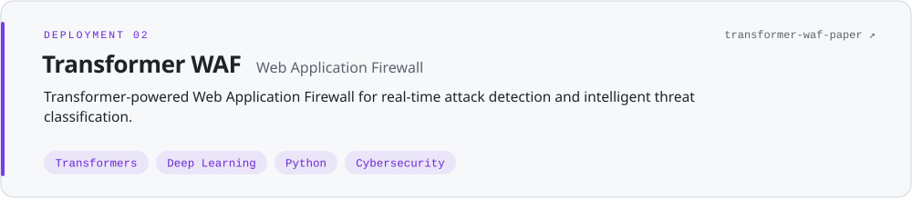
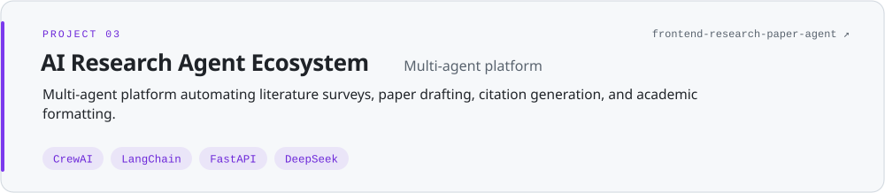

  <i>“But when that which is complete and perfect comes, that which is incomplete and partial will pass away.”</i> 
  1 Corinthians 13:10

<a href="https://priscillaportfolio.vercel.app/">
  <picture>
    <source media="(prefers-color-scheme: dark)" srcset="assets/hero-dark.svg">
    
  </picture>
</a>

  
  
  

 

## `01` About

| Role | AI Engineer · ML Researcher · Full Stack Developer |
| :-- | :-- |
| **Education** | B.Tech AI & Data Science — Karunya Institute of Science and Technology |
| **Currently** | MAWM Trainee @ NCS Partners, Coimbatore |
| **Interests** | LLMs · Agentic AI · Computer Vision · Deep Learning |
| **Driven by** | Transforming research ideas into deployable AI products |
| **Exploring** | Enterprise AI Systems · AI for Healthcare |

 

## `02` Experience

| Period | Role | Highlights |
| :-- | :-- | :-- |
| **Aug 2026 → Present** | MAWM Trainee · **NCS Partners**, Coimbatore | Current role |
| **May 2026 → Jul 2026** | AI Engineer Intern · **Rapha MedTech** | Built AI-powered healthcare applications |

 

## `03` Tech Stack

| Area | Tools |
| :-- | :-- |
| **Language** | <picture><source media="(prefers-color-scheme: dark)" srcset="https://skillicons.dev/icons?i=python,typescript,javascript&theme=dark"></picture> |
| **Deep learning & vision** | <picture><source media="(prefers-color-scheme: dark)" srcset="https://skillicons.dev/icons?i=pytorch,tensorflow,sklearn,opencv&theme=dark"></picture> |
| **LLMs & agents** | `LangChain` `CrewAI` `RAG` `Vector DB` `DeepSeek` |
| **Backend** | <picture><source media="(prefers-color-scheme: dark)" srcset="https://skillicons.dev/icons?i=fastapi,django,nodejs&theme=dark"></picture> |
| **Frontend** | <picture><source media="(prefers-color-scheme: dark)" srcset="https://skillicons.dev/icons?i=react,nextjs&theme=dark"></picture> |
| **Data** | <picture><source media="(prefers-color-scheme: dark)" srcset="https://skillicons.dev/icons?i=mongodb,postgres&theme=dark"></picture> |
| **Infra** | <picture><source media="(prefers-color-scheme: dark)" srcset="https://skillicons.dev/icons?i=docker,git,linux&theme=dark"></picture> |

 

## `04` Projects

<a href="https://github.com/PriscillajospinG/PrivAI-Secure-Enterprise-AI-Assistant">
  <picture>
    <source media="(prefers-color-scheme: dark)" srcset="assets/project-privai-dark.svg">
    
  </picture>
</a>

<a href="https://github.com/PriscillajospinG/transformer-waf-paper">
  <picture>
    <source media="(prefers-color-scheme: dark)" srcset="assets/project-transformer-waf-dark.svg">
    
  </picture>
</a>

<a href="https://github.com/PriscillajospinG/frontend-research-paper-agent">
  <picture>
    <source media="(prefers-color-scheme: dark)" srcset="assets/project-research-agent-dark.svg">
    
  </picture>
</a>

  

## `05` Achievements & Activity

| Event | Recognition |
| :-- | :-- |
| **Cyberthon 2025** | 🥇 Special Mention Award |
| **Smart India Hackathon** | Participant |

  <picture>
    <source media="(prefers-color-scheme: dark)" srcset="https://github-readme-stats.vercel.app/api?username=PriscillajospinG&show_icons=true&hide_border=true&count_private=true&bg_color=161b22&title_color=a78bfa&icon_color=8b5cf6&text_color=e6edf3">
    
  </picture>
  <picture>
    <source media="(prefers-color-scheme: dark)" srcset="https://github-readme-stats.vercel.app/api/top-langs/?username=PriscillajospinG&layout=compact&hide_border=true&langs_count=6&bg_color=161b22&title_color=a78bfa&text_color=e6edf3">
    
  </picture>

  <picture>
    <source media="(prefers-color-scheme: dark)" srcset="https://streak-stats.demolab.com?user=PriscillajospinG&hide_border=true&background=161b22&ring=8b5cf6&fire=8b5cf6&currStreakLabel=a78bfa&sideLabels=e6edf3&dates=8b949e&sideNums=e6edf3&currStreakNum=e6edf3&stroke=30363d">
    
  </picture>

 

## `06` Connect

  
  
  

 

  <picture>
    <source media="(prefers-color-scheme: dark)" srcset="https://raw.githubusercontent.com/PriscillajospinG/PriscillajospinG/output/github-contribution-grid-snake-dark.svg">
    
  </picture>

